# ACPDAD: Adaptive Cyber-Physical Drone Attack Detection

[](https://opensource.org/licenses/MIT)
[](https://www.python.org/downloads/)
[](https://github.com/ArduPilot/ardupilot/releases/tag/Copter-4.7.2)
[](https://software.ardupilot.org/mavproxy/)

**ACPDAD** (Adaptive Cyber-Physical Drone Attack Detection) is a reproducible, dual-domain research framework for detecting cyber-physical and network attacks against unmanned aerial vehicles (UAVs). It provides both an isolated synthetic data and modeling pipeline and a real-time, Software-In-The-Loop (SITL) MAVLink telemetry detector integrated with ArduPilot.

---

## 1. Project Overview & Two Core Workflows

ACPDAD contains two cleanly separated, non-conflicting research pathways:

```mermaid
flowchart TD
    subgraph Synthetic ["1. Custom Synthetic Simulator Pipeline"]
        S_GEN[Flight & Network Simulator] --> S_DATA[150k Synthetic Observations<br/>data/train_validation, data/frozen_test]
        S_DATA --> S_MODEL[Synthetic Model Checkpoint<br/>models/selected]
        S_MODEL --> S_EVAL[Frozen Evaluation Evidence<br/>results/frozen_test]
    end

    subgraph SITL ["2. ArduPilot SITL / MAVLink Pipeline"]
        A_COPTER[ArduCopter 4.7.2 SITL<br/>TCP :5760] --> M_PROXY[MAVProxy Bridge]
        M_PROXY -->|Controller Route :14550| C_CTRL[ACPDAD Mission Controller]
        M_PROXY -->|Detector Route :14552| S_RELAY[Scenario Relay<br/>DoS / Replay / FDI]
        S_RELAY -->|MAVLink UDP :14551| T_ADAPT[Telemetry Feature Adapter<br/>Cross-Sensor Residuals]
        T_ADAPT --> D_MODEL[SITL Detector Model<br/>models/sitl]
        D_MODEL --> D_EVAL[200-Mission Benchmark<br/>results/sitl]
    end
```



1. **Custom Synthetic Workflow:** Generates simulated vehicle physics and 802.11 network traffic, covering 5 attack classes (`Benign`, `DoS`, `Replay`, `Evil_Twin`, `FDI`). Evaluated on a frozen 150,000-observation test suite.
2. **ArduPilot SITL / MAVLink Production Workflow:** Operates over localhost loopback sockets with a live virtual quadcopter running official ArduCopter firmware. Features cross-measurement barometric/GPS physical residuals, absolute altitude decoupling, and an online causal watchdog for DoS detection. Evaluated on a preregistered 200-mission benchmark across 4 supported classes (`Benign`, `DoS`, `Replay`, `FDI`).

---

## 2. Quick Start & Execution Guide

### 2.1 Environment Setup & Shell Activation

ACPDAD runs within a pinned Python virtual environment. Activate it using the syntax appropriate for your shell:

```bash
# Standard POSIX / Bash / Zsh
cd /run/media/schrodingerspet/D/Restricted/Projects/ACPDAD
source .venv/bin/activate
```

```fish
# Fish Shell
cd /run/media/schrodingerspet/D/Restricted/Projects/ACPDAD
source .venv/bin/activate.fish
```

> **Tip:** You can also run any command directly without activating your shell by prefixing with `.venv/bin/python` (e.g. `.venv/bin/python run_project.py ...`).

---

### 2.2 Prerequisites & Pre-Flight Verification

1. **Install Dependencies:**
   ```bash
   .venv/bin/python -m pip install -r requirements-sitl.txt -c requirements.txt
   ```

2. **Build and Configure ArduPilot Copter SITL (pinned tag `Copter-4.7.2`):**
   ```bash
   ARDUPILOT_HOME="$PWD/.sitl/ardupilot" scripts/setup_ardupilot_sitl.sh
   python run_project.py sitl doctor --json
   ```

3. **Run Automated Pre-Flight Self-Checks (23/23 PASS):**
   Validates feature mapping, MAVLink serialization, causal history isolation, and scenario injection boundaries without starting SITL:
   ```bash
   python run_project.py sitl selfcheck
   ```

4. **Verify Synthetic Baseline Contract (0 Errors):**
   Validates all 81,056 rows across 300 runs against frozen cryptographic checksums:
   ```bash
   python run_project.py verify
   ```

---

### 2.3 Flying Live SITL Missions with Real-Time Detection

The `sitl run` subcommand orchestrates ArduCopter SITL, the MAVProxy bridge, automated route navigation, attack injection, and the live in-terminal [`TerminalDashboard`](src/acpdad/sitl/dashboard.py).

#### A. Showcase: Concurrent Multi-Attack Flight (FDI + DoS + Replay across 2 laps)
Flies a 2-lap circuit (16 waypoints, 15m altitude, 16 m/s) with concurrent altitude tampering (+5.0m step), packet dropping (33% DoS), and historical replay (5.0s delay). All injections automatically halt upon completing Lap 2, allowing a clean return-to-home and landing:

```bash
# Standard Bash
python run_project.py sitl run \
  --scenario combined \
  --run-id live_concurrent_001

# Fish Shell (single-line syntax)
python run_project.py sitl run --scenario=combined --run-id=live_concurrent_001
```

#### B. Individual Attack Scenarios
```bash
# False Data Injection (FDI) - Step altitude tampering (+5m)
python run_project.py sitl run --scenario FDI --fdi-subtype step --duration 30 --run-id sitl_fdi_step_001

# False Data Injection (FDI) - Drift altitude ramp (+0.2m/s)
python run_project.py sitl run --scenario FDI --fdi-subtype drift --duration 30 --run-id sitl_fdi_drift_001

# Denial of Service (DoS) - Packet drops
python run_project.py sitl run --scenario DoS --duration 30 --run-id sitl_dos_flight_001

# Replay Attack - 2.0s historical datagram delay
python run_project.py sitl run --scenario Replay --replay-delay 2.0 --duration 30 --run-id sitl_replay_flight_001

# Clean Benign Baseline Flight
python run_project.py sitl run --scenario benign --duration 30 --run-id sitl_benign_flight_001
```

#### C. Headless Mode (CI / Remote Server Execution)
By default, the runner auto-launches or forwards to QGroundControl on UDP `127.0.0.1:14600`. To run in headless environments without a display or QGroundControl:
```bash
python run_project.py sitl run --scenario combined --headless --run-id sitl_headless_001
```

*Every run saves flight logs, telemetry captures, and label-free predictions under `results/sitl/runs/<run_id>/`.*

---

### 2.4 Manual Component Control (Step-by-Step Multi-Terminal)

If you prefer running individual system daemons in separate terminal windows:

```bash
# Terminal 1: Launch ArduPilot SITL and MAVProxy loopback router
python run_project.py sitl start

# Terminal 2: Listen, adapt MAVLink packets, and record telemetry
python run_project.py sitl capture --output results/sitl/manual_capture.csv

# Terminal 3: Command takeoff, waypoints, and landing
python run_project.py sitl controller --altitude 15.0 --duration 30

# Clean shutdown of background simulation processes
python run_project.py sitl stop
```

---

### 2.5 Synthetic Research Pipeline Operations

For offline dataset generation, training, threshold calibration, and validation replays:

```bash
# Replay a specific validation mission through the synthetic model
python run_project.py demo --data data/train_validation --model models/selected \
  --split val --run-id run_000042 --output results/replays/validation_demo

# Generate new synthetic flight & network observations
python run_project.py generate --output data/new_dataset --runs 100

# Train classifier model
python run_project.py train --data data/train_validation --output models/new_model

# Calibrate detection thresholds and persistence windows
python run_project.py calibrate-alerts --data data/train_validation --model models/new_model

# Evaluate against frozen benchmark suite
python run_project.py evaluate --data data/frozen_test --model models/new_model --output results/evaluation
```

---

## 3. Dedicated SITL Detector & Key Innovations

The production SITL detector (`models/sitl/checkpoint.pkl`) and flight architecture resolve the core failure modes of earlier iterations:

- **In-Place Rich Terminal Dashboard (`TerminalDashboard`):** Renders an auto-refreshing in-place console view using `rich.live.Live` displaying flight state, real-time telemetry (altitude, speed, heading), active mutation/drop/replay meters, live ML inference with freshness badges (`[FRESH <0.2s]` vs `[NO FRESH PREDICTION (STALE)]`), vertical physical residuals ($r_z$), and scrolling event logs. Eliminates web server overhead, port leaks, and browser latency.
- **Concurrent Multi-Attack Engine (`CombinedScenarioPolicy`):** Interleaves False Data Injection (+5.0m step), Denial of Service (33% bounded packet drop), and Replay attacks (5.0s historical buffer) simultaneously across 2 full circuit laps.
- **Dynamic Route Deactivation (`on_circuit_completed`):** Automatically terminates all attack injectors the exact moment the 2nd lap of waypoints completes, ensuring return-to-home, descent, touchdown, and motor disarm occur under clean nominal telemetry without crashing.
- **Cross-Sensor Physical Consistency (`abs(GPI.alt - VFR.alt)`):** In ArduPilot SITL, FDI mutations alter `GLOBAL_POSITION_INT` (relative and AMSL altitude), while independent `VFR_HUD` (baro altitude AMSL) is forwarded unmodified. In benign flights, $\lvert \text{GPI.alt} - \text{VFR.alt} \rvert \le 0.64$m (mean 0.04m), whereas during FDI attacks this discrepancy persists at $1.5$m to $5.0$m for the entire attack duration. Adding this physical residual while zeroing raw altitude completely solves altitude confounding without false alarms on benign climbs.
- **Strictly Causal DoS Watchdog:** Monitors arrival gaps with threshold $\tau_{\text{silence}} = 0.450$s learned from benign development flights (mean 0.250s, max 0.295s). Operates without ground-truth labels.
- **Causal Operational Persistence:** Delivered attack classifications causally hold operational alert state for 0.5s, maintaining the alert across dropped intermediate packets.
- **Three-Way Parallel SITL Execution:** Uses non-colliding socket ports (`-I 0, 1, 2`) allowing 3 parallel SITL missions to execute simultaneously on localhost, reducing 200-mission benchmark runtime from 4.5 hours to ~45 minutes.

---

## 4. Benchmark Results & Scorecard

### 4.1 Comparative Evaluation on 80 Fresh Locked Test Missions

Evaluation of 80 unseen test missions (20 Benign, 20 DoS, 20 Replay, 20 FDI; 38,035 scheduled observations, 24,160 delivered scored observations) under protocol lock `results/sitl/test_protocol/sitl_test_lock.json` (`fc74fc92...`):

| Evaluation Metric | Synthetic Transfer Baseline | SITL Production Detector | Fixed Target | Result |
| :--- | :---: | :---: | :---: | :---: |
| **FDI Scored-Row Precision** | 11.35% (1,097 / 9,668) | **94.77% (1,106 / 1,167)** | $\ge 80.0\%$ | **PASS** |
| **FDI Operational End-to-End Recall** | 93.52% (1,791 / 1,915) | **93.47% (1,790 / 1,915)** | $\ge 80.0\%$ | **PASS** |
| **DoS Operational End-to-End Recall** | 86.49% (1,651 / 1,909) | **87.17% (1,664 / 1,909)** | $\ge 70.0\%$ | **PASS** |
| **DoS Operational Alert Precision** | 9.39% (1,651 / 17,586) | **49.75% (1,664 / 3,345)** | $\ge 80.0\%$ | **FAIL** |
| **Replay Precision (Operational)** | 0.00% (0 / 0) | **83.22% (1,706 / 2,050)** | $\ge 90.0\%$ | **FAIL** |
| **Replay Scored-Row Recall** | 0.00% (0 / 1,034) | **90.52% (936 / 1,034)** | $\ge 90.0\%$ | **PASS** |
| **Replay Operational Recall** | 0.00% (0 / 1,901) | **89.74% (1,706 / 1,901)** | $\ge 90.0\%$ | **FAIL** *(missed by 0.26%)* |
| **Benign Scored-Row False-Positive Rate** | 93.86% (19,785 / 21,079) | **1.72% (362 / 21,079)** | $\le 5.0\%$ | **PASS** |
| **Overall Received Coverage** | 63.52% (24,160 / 38,035) | **63.52% (24,160 / 38,035)** | $\ge 95.0\%$ | **FAIL** |
| **Timely Alert Rate (DoS / Replay / FDI)** | 100% / 0% / 100% | **100.0% / 100.0% / 100.0%** | $\ge 80.0\%$ | **PASS** |
| **Mean Attack-Alert Delay** | 0.16 s | **0.21 s** | $\le 2.0$ s | **PASS** |
| **Benign False Alerts / Minute** | 22.40 | **1.46** | $\le 0.35$ | **FAIL** |

Detailed findings, confusion matrices, and per-mission metrics are in [`results/sitl/EVALUATION_REPORT.md`](results/sitl/EVALUATION_REPORT.md).

---

## 5. Repository Structure

```
ACPDAD/
├── config/
│   ├── simulation.json            # Synthetic flight/network simulator configuration
│   ├── sitl.json                  # Pinned localhost SITL endpoints, thresholds, scenarios
│   └── sitl_transfer_test.json    # Dedicated transfer test parameters
├── data/
│   ├── train_validation/          # Synthetic training and validation dataset
│   ├── validation/                # Multi-condition synthetic validation splits
│   └── frozen_test/               # Frozen synthetic evaluation benchmark
├── docs/
│   ├── SITL_MAVLINK.md            # Comprehensive SITL architecture and protocol specification
│   └── Final Year Project Information/ # Preserved proposal and academic reference materials
├── models/
│   ├── selected/                  # Frozen custom synthetic model checkpoint & manifest
│   └── sitl/                      # Production ArduPilot SITL detector checkpoint & manifest
├── notebooks/
│   ├── 01_dataset_exploration.ipynb   # Guided synthetic dataset exploration
│   ├── 02_training_and_validation.ipynb # Model training, feature extraction, calibration
│   └── 03_frozen_results_analysis.ipynb # Read-only synthetic benchmark analysis
├── results/
│   ├── frozen_test/               # Frozen synthetic benchmark evaluation evidence
│   ├── historical/                # Preserved historical development records
│   ├── sitl/                      # Production SITL benchmark evidence:
│   │   ├── EVALUATION_REPORT.md   # Unabridged final evaluation report
│   │   ├── test_protocol/         # Cryptographic pre-generation protocol lock
│   │   └── evaluation/            # Comparative metrics, confusion matrices, CSVs
│   └── verification/              # Automated self-check and verification reports
├── scripts/
│   ├── setup_ardupilot_sitl.sh    # Automated ArduPilot SITL environment builder
│   ├── run_live_demo.py           # Showcase flight demo with automated dashboard
│   └── run_sitl_study.py          # Parallel SITL mission generator, trainer & evaluator
├── src/
│   └── acpdad/
│       ├── simulation.py          # Synthetic physics and network generator
│       ├── feature_extraction.py  # Causal temporal feature engineering
│       ├── workflow.py            # Synthetic pipeline driver
│       └── sitl/                  # Complete ArduPilot SITL / MAVLink integration:
│           ├── adapter.py         # MAVLink feature adapter & cross-sensor residuals
│           ├── capture.py         # Non-intrusive detector receiver & message logging
│           ├── cli.py             # CLI parser for `run_project.py sitl`
│           ├── controller.py      # MAVLink GUIDED takeoff, hover, land controller
│           ├── dashboard.py       # In-place Rich terminal dashboard for live flight metrics
│           ├── detector.py        # Causal TransferDetector with physical residual evaluation
│           ├── runner.py          # SITL process lifecycle & multi-instance port management
│           ├── scenarios.py       # Deterministic scenario relay (DoS, Replay, FDI, Combined)
│           ├── verification.py    # Automated 23-item SITL self-check suite
│           └── watchdog.py        # CausalTelemetryWatchdog online silence monitor
├── README.md                      # Project documentation
├── requirements.txt               # Pinned base synthetic dependencies
├── requirements-sitl.txt          # Pinned SITL dependencies (pymavlink, pexpect, etc.)
└── run_project.py                 # Main CLI entrypoint for both synthetic and SITL workflows
```

---

## 6. Cryptographic Hashes & Baseline Preservation

All protected baseline assets remain 100% byte-for-byte identical to their pre-registered states:

| Asset Name | File Path | SHA-256 Checksum |
| :--- | :--- | :--- |
| **Synthetic Checkpoint** | `models/selected/checkpoint.pkl` | `cdbe7a1b7fba8823c3c17ca722b34002c0852de446c5e7e0a41ba878a741bc4d` |
| **Synthetic Manifest** | `models/selected/manifest.json` | `adcedbdf79d8555cc11155ac7e3168db03d93a060662760149f47d1bc3ce517d` |
| **Frozen Test Lock** | `results/frozen_test/pre_generation_lock.json` | `66f905181503db16f8e6610d86d6e0b2c4820b71da6e1be276b8693edd000965` |
| **SITL Detector Checkpoint** | `models/sitl/checkpoint.pkl` | `3136fe66c123a51a38bea30ba502aeda8fdc3ae326fc5494bcef0393561698ac` |
| **SITL Protocol Lock** | `results/sitl/test_protocol/sitl_test_lock.json` | `fc74fc92d0d291730a764ed88efd0876df2cce7e470e205b7a763e51927f8802` |

---

## 7. Operational Boundaries & Disclaimer

> [!WARNING]
> **Scope of Validation:** All claims and performance evaluations apply exclusively to localhost loopback simulations (ArduPilot SITL on Linux and the custom synthetic generator).
> - **No Over-The-Air Wi-Fi Radio Claims:** The MAVLink telemetry pipeline does not decode 802.11 physical frames. `Evil_Twin` detection is unsupported in MAVLink without an auxiliary WLAN simulator.
> - **No Physical UAV Flight Claims:** Evaluation has not been conducted on physical flight computers (Pixhawk, Cube) or in open-air flight tests.
