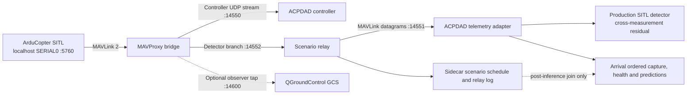

# ArduPilot SITL and MAVLink integration

**Status:** SITL/MAVLink integration is verified and operational on localhost. Live ArduCopter SITL missions (benign, FDI, DoS, and Replay) have run and demonstrably completed cleanly on this host. Live heartbeats and MAVLink telemetry reach ACPDAD via the documented localhost route with zero data synthesis. All results, manifests, and packet ledgers are stored in `results/sitl/runs/`. Details are recorded in `results/sitl/INTEGRATION_STATUS.md`.

## Architecture



The controller connects to MAVProxy's localhost UDP output on port `14550`. MAVProxy connects to SITL SERIAL0 and forwards telemetry and controller return commands through this loopback endpoint; it also sends a separate detector branch to the scenario relay. ACPDAD binds UDP only to `127.0.0.1`; the relay is the only component that applies a scenario to the detector branch. The controller sees the upstream SITL messages, not the detector-side transformation. The mission controller uses only local SITL command messages and performs GUIDED takeoff, hold, and LAND; it cannot connect to physical devices through this command path.

The ArduPilot SITL executable uses its built-in simulated vehicle dynamics. No external flight simulator or physical hardware is required. The communication path carries MAVLink messages produced by ArduPilot SITL, not generated records from `src/acpdad/simulation.py`.

## Pinned versions and connection settings

| Component | Pin | Reason / endpoint |
| --- | --- | --- |
| ArduPilot Copter | `Copter-4.7.2` tag | Stable release pinned for the integration; do not use the newer beta for reproducibility |
| MAVProxy | `1.8.75` | MAVLink bridge and local ground-station command interface |
| pymavlink | `2.4.50` | Python MAVLink 2 parser/encoder and controller connection |
| pexpect | `4.9.0` | Python subprocess interface used by ArduPilot's `sim_vehicle.py` |
| MAVLink | v2, `ardupilotmega` dialect | Parsed using the `pymavlink` dialect |
| SITL SERIAL0 | `tcp:127.0.0.1:5760` | MAVProxy master |
| Controller route | `udpin:127.0.0.1:14550` | MAVProxy output consumed by ACPDAD controller |
| MAVProxy controller forward | `udp:127.0.0.1:14550` | Controller telemetry and return-command route |
| Relay input | `udp:127.0.0.1:14552` | MAVProxy detector branch |
| Detector input | `udp:127.0.0.1:14551` | Relay-to-adapter branch |

The defaults are specified in `config/sitl.json`. The setup script clones the exact ArduPilot tag into `.sitl/ardupilot` (ignored by Git), selects ArduPilot's bundled Arch, Ubuntu, or Debian prerequisite installer when enabled, and builds the Copter SITL binary. Set `INSTALL_SYSTEM_DEPS=0` only if the OS prerequisites are already installed. The SITL Python packages are pinned separately in `requirements-sitl.txt` so the custom synthetic dependencies are not changed.

Official references:

- [ArduPilot SITL setup on Linux](https://docs.ardupilot.org/dev/docs/setting-up-sitl-on-linux.html)
- [ArduPilot Arch prerequisite script at the pinned tag](https://github.com/ArduPilot/ardupilot/blob/Copter-4.7.2/Tools/environment_install/install-prereqs-arch.sh)
- [ArduPilot SITL architecture and default ports](https://ardupilot.org/dev/docs/sitl-simulator-software-in-the-loop.html)
- [ArduPilot UARTs and localhost serial endpoints](https://ardupilot.ardupilot.org/dev/docs/learning-ardupilot-uarts-and-the-console.html)
- [MAVProxy forwarding and command-line options](https://software.ardupilot.org/mavproxy/docs/getting_started/starting.html)
- [MAVProxy FAQ on command forwarding from output sub-clients](https://ardupilot.org/mavproxy/docs/getting_started/faq.html)
- [MAVLink Python connection and `recv_match`](https://mavlink.io/en/mavgen_python/)
- [MAVLink common message definitions](https://mavlink.io/en/messages/common.html)
- [ArduPilot Copter releases](https://github.com/ArduPilot/ardupilot/releases)
- [pymavlink releases](https://pypi.org/project/pymavlink/)
- [MAVProxy releases](https://pypi.org/project/MAVProxy/)

## Install and run

```bash
.venv/bin/python -m pip install -r requirements-sitl.txt -c requirements.txt
ARDUPILOT_HOME="$PWD/.sitl/ardupilot" scripts/setup_ardupilot_sitl.sh
.venv/bin/python run_project.py sitl doctor --json
```

The complete run is the recommended first demonstration:

```bash
.venv/bin/python run_project.py sitl run --scenario benign --duration 30 --run-id sitl_benign_001
```

This command creates a fresh folder under `results/sitl/runs/`, starts the SITL process with MAVProxy disabled inside `sim_vehicle.py`, starts a separately configured MAVProxy bridge, binds ACPDAD relay and receiver sockets to loopback, connects the controller through MAVProxy's controller-facing UDP port, confirms heartbeat and takeoff, runs the mission, lands, writes logs and evidence, and stops child processes. The relay schedule begins only after the controller confirms the vehicle has taken off. On a failed run, its logs and partial capture are retained and the command exits with an error.

For separate processes, start the session, then start capture before the controller so the telemetry ledger includes the complete mission. Use three terminals:

```bash
.venv/bin/python run_project.py sitl start --session-dir results/sitl/sessions/manual_001
```

```bash
.venv/bin/python run_project.py sitl capture --session-dir results/sitl/sessions/manual_001 --scenario benign --duration 45
```

```bash
.venv/bin/python run_project.py sitl controller --session-dir results/sitl/sessions/manual_001 --duration 30
```

Then stop the session:

```bash
.venv/bin/python run_project.py sitl stop --session-dir results/sitl/sessions/manual_001
```

For a capture running alongside the controller, start `capture` while the controller session is active. In this manual mode the scenario clock starts when capture starts. Use the integrated `run` command for the takeoff-anchored schedule.

Re-run inference from a saved capture:

```bash
.venv/bin/python run_project.py sitl infer \
  --run-dir results/sitl/runs/sitl_benign_001/capture \
  --model models/selected \
  --output results/sitl/runs/sitl_benign_001/capture/predictions_reinferred_label_free.csv
```

The default output path for `sitl infer` is `predictions_reinferred_label_free.csv`; the output is created exclusively and is not overwritten.

## Detector feature mapping

`src/acpdad/sitl/adapter.py` emits one base row for each received `GLOBAL_POSITION_INT`, in MAVLink arrival order. It consumes `ATTITUDE` only if it arrived recently enough. The 22 base names and 88 temporal column ordering match the selected model's input dimensions, but this is a **source-specific mapping** named `acpdad-sitl-mavlink-v1`, not the synthetic feature contract. Each row contains an arrival timestamp from the receiving host's monotonic clock and a `time_boot_ms` source timestamp from the autopilot; the adapter never subtracts those unsynchronized clocks to invent packet age.

| Feature group | MAVLink source / mapping | Availability |
| --- | --- | --- |
| Relative height | `GLOBAL_POSITION_INT.relative_alt`, mm → cm | Supported |
| X/Y/down velocity | `GLOBAL_POSITION_INT.vx/vy/vz`, cm/s → m/s; Z remains positive down | Supported |
| Roll, pitch, yaw | Recent `ATTITUDE`, radians → degrees | Supported when the message is fresh |
| Source-time regression | `GLOBAL_POSITION_INT.time_boot_ms` compared with prior received source time | Supported |
| Sequence regression/gap | MAVLink per-system/component 8-bit packet sequence, modulo 256 | Supported; not the synthetic 12-bit or Wi-Fi sequence |
| Duplicate payload | SHA-256 of received MAVLink frame in a 30-frame causal history | Supported |
| Arrival delta and received rate | Receiver monotonic timestamps; received frames in the one-second window | Supported |
| Frame length | MAVLink frame byte count | Supported |
| Vertical consistency residual | Consecutive relative altitude and down-positive vertical speed over positive source-time delta | Supported when both observations are valid and connected |
| Packet age/excess | Host monotonic clock versus autopilot boot clock | Unavailable; `NaN` |
| AP change/association duration | Wi-Fi association and BSSID state | Unavailable; `NaN` |
| Management frame | 802.11 frame subtype | Unavailable; `NaN` |

Temporal features are causal raw values, rolling mean, rolling sample standard deviation (`ddof=1`), and first difference over `W=10`. The window resets on a run change, malformed/invalid required position observation, or a position delivery gap larger than the configured limit. Physics residual and health warnings are surfaced as candidates with explicit transfer-calibration status; a telemetry gap is not itself an Evil_Twin prediction.

The model call receives only the 22 base values or their causal transforms. `run_id`, message sequence, arrival/source timestamps, scenario configuration, and ground truth are metadata. Ground truth is written into a separate sidecar and joined to prediction rows only after inference. The selected HistGradientBoosting checkpoint can accept missing values, but the SITL feature distribution was not used for training. Its predictions and synthetic-trained alert thresholds are therefore diagnostic only and must not be presented as validated SITL detector performance.

## Implemented scenario meaning and limits

| Scenario | Detector-facing stream behavior | What this does not claim |
| --- | --- | --- |
| Benign | Unmodified SITL MAVLink stream | Does not establish general benign flight performance |
| FDI | Rewrite altitude fields in `GLOBAL_POSITION_INT`; step, drift, intermittent, or coordinated subtype. Original upstream datagram and rewritten output hash are logged separately. | Does not change ArduPilot's internal vehicle state or inject a command to the vehicle |
| DoS | Drop every configured Nth detector-facing `GLOBAL_POSITION_INT` datagram. Offered upstream data and delivered outputs are separately counted. | Does not model RF jamming, an over-the-air flood, or a saturated radio link |
| Replay | Substitute a prior exact `GLOBAL_POSITION_INT` MAVLink datagram captured by the local relay. The payload, source time and sequence stay stale; arrival time is newly recorded by the receiver. Repetition count is configurable. | Does not claim capture/replay over a radio link |
| Evil_Twin | Unsupported in this path; the command rejects it explicitly. | MAVLink by itself cannot model Wi-Fi AP impersonation, BSSID selection, roaming or 802.11 management traffic |

The proposal/context file in `docs/Final Year Project Information/` says the main selected scenarios are FDI, DoS and Replay, and notes Evil Twin as additional discussion rather than an established implementation. If the final project requirement includes a Wi-Fi Evil Twin, integrate a separate isolated WLAN simulator (for example virtual AP/station namespaces) and a separate wireless event adapter. Do not call endpoint substitution or a MAVLink proxy change an Evil Twin attack.

## Outputs and evidence

Each SITL capture folder includes:

- `schema.json`, `config.json`, and `run_manifest.json` with provenance, versions, endpoint addresses, message types and checkpoint digest.
- `received_messages.jsonl` with ordered decoded message metadata and the exact received frame bytes in hex.
- `features.csv` and `predictions_label_free.csv`, with no labels or attack schedule.
- `health_events.jsonl` for telemetry and position-message gaps/recovery, distinct from attack classifications.
- `relay_events.jsonl` and `ground_truth_joined_after_inference.csv` for attack schedule, pre/post relay packet hashes, loss/replay effects, and the post-inference mapping.
- `metrics.json`, process logs, controller command/acknowledgment records, and a SHA-256 file manifest.

The transfer-run metric timeline is based on upstream position observations arriving at the relay. Dropped observations are retained as unavailable misses. It is single-run transfer evidence, not an independent-seed population estimate. The frozen synthetic test, its lock, predictions and report are not touched by SITL commands.

## QGroundControl visualization and multi-lap flight route

ACPDAD provides integrated real-time flight visualization via QGroundControl using the existing ArduPilot SITL simulator and MAVProxy bridge without running a secondary simulator or altering controller or detector telemetry routes.

### Mandatory Interactive Visualization

For the interactive demonstration (`run_project.py sitl run`), QGroundControl is **required by default**:
- The runner automatically checks if QGroundControl is already listening on dedicated UDP port `14600` (or auto-launches the local AppImage when a desktop display is available).
- If QGroundControl is neither listening nor able to bind within the startup timeout, the workflow halts before arming/takeoff with a clear error prompt.
- For automated batch jobs, researcher test sweeps, or CI environments where visualization is unnecessary, pass `--headless`.

```bash
# Interactive demonstration (requires QGroundControl and flies a 3-lap perimeter route):
.venv/bin/python run_project.py sitl run --scenario benign --run-id sitl_qgc_route_demo_001

# Automated headless execution (no GUI required):
.venv/bin/python run_project.py sitl run --scenario benign --duration 30 --headless
```

### Repeatable Multi-Kilometer Flight Circuit

In the interactive benign demonstration, the simulated vehicle visibly navigates across the QGroundControl map in a substantial multi-kilometer circuit around the Canberra Airport airfield rather than hovering statically in place:
- **Geometry & Scale:** 8-waypoint balanced oval/octagonal circuit centered on the Canberra Airport launch position $(lat_0, lon_0)$ at $15.0$m altitude AGL with north span $L_N = 180.0$m and east span $L_E = 120.0$m:
  - Waypoint 1 (North-East 1): $(lat_0 + L_N, lon_0 + 0.5 \cdot L_E)$
  - Waypoint 2 (North-East 2): $(lat_0 + 0.5 \cdot L_N, lon_0 + L_E)$
  - Waypoint 3 (South-East 1): $(lat_0 - 0.5 \cdot L_N, lon_0 + L_E)$ (Eastern straight leg, $180$m)
  - Waypoint 4 (South-East 2): $(lat_0 - L_N, lon_0 + 0.5 \cdot L_E)$
  - Waypoint 5 (South-West 1): $(lat_0 - L_N, lon_0 - 0.5 \cdot L_E)$ (Southern straight leg, $120$m)
  - Waypoint 6 (South-West 2): $(lat_0 - 0.5 \cdot L_N, lon_0 - L_E)$
  - Waypoint 7 (North-West 1): $(lat_0 + 0.5 \cdot L_N, lon_0 - L_E)$ (Western straight leg, $180$m)
  - Waypoint 8 (North-West 2): $(lat_0 + L_N, lon_0 - 0.5 \cdot L_E)$ (Northern straight leg, $120$m)
- **Lap Distance & Total Flight:** Each lap covers $\approx 1.0$ km ($997$m); 2 complete laps cover $\approx 2.0$ km across the airfield. Flight duration is approximately 60–75 wall-clock seconds (with $2\times$ simulation speedup), preserving battery capacity (>80% remaining).
- **Cruise Speed & Guidance:** High-speed cruise at $16.0$ m/s (`WP_SPD`) with $15.0$m waypoint acceptance radius for smooth, realistic turns. Targets are dispatched via `SET_POSITION_TARGET_GLOBAL_INT` (`MAV_FRAME_GLOBAL_RELATIVE_ALT_INT`, type mask 3576) and acknowledged via `COMMAND_INT` (`MAV_CMD_DO_REPOSITION`).
- **Pre-Arm Initialization Waiting:** The controller actively verifies sensor calibration, gyro init, 3D GPS fix (`GPS_RAW_INT.fix_type >= 3`), and EKF3 navigation alignment (`EKF_STATUS_REPORT` and `SYS_STATUS` pre-arm health check) before issuing the arm command, completely eliminating premature "Arm: System not initialised" or "PreArm: Need Position Estimate" failures.
- **Telemetry Confirmation & Progress:** Telemetry is actively verified using `GLOBAL_POSITION_INT` until horizontal distance to the target waypoint is $\le 15.0$m before advancing to the next waypoint.
- **Return to Home, Landing & Post-Landing Hold:** After completing all laps, the vehicle returns to the launch position, holds for 0.5s, switches to `LAND` mode, and confirms disarming. A 15-second post-landing hold keeps the telemetry stream open so QGroundControl displays the landed state and the entire multi-kilometer circuit trace without premature "Comms Lost" disconnects.
- **Live In-Flight Attack Demonstrations:** The interactive flight route also serves as the operational flight envelope for live in-flight attack demonstrations (`FDI`, `DoS`, and `Replay`). The drone flies the balanced 2-lap circuit ($2,065.4$m total distance, 16 waypoints, 16.0 m/s cruise speed) while attacks are injected deterministically onto ACPDAD's detector relay branch during flight, allowing simultaneous visualization of vehicle dynamics in QGroundControl and real-time detection in ACPDAD.

### Live In-Flight Attack Demonstration Commands & Stream Separation

```bash
# 1. Live In-Flight False Data Injection (FDI):
.venv/bin/python run_project.py sitl run --scenario FDI --attack-start 15.0 --attack-duration 25.0 --run-id sitl_qgc_route_fdi_001

# 2. Live In-Flight Denial of Service (DoS):
.venv/bin/python run_project.py sitl run --scenario DoS --attack-start 15.0 --attack-duration 25.0 --run-id sitl_qgc_route_dos_001

# 3. Live In-Flight Stale Telemetry Replay:
.venv/bin/python run_project.py sitl run --scenario Replay --attack-start 20.0 --attack-duration 20.0 --run-id sitl_qgc_route_replay_001
```

#### Stream Separation and Scope Distinction
1. **Physical SITL Vehicle & Controller Stream (`tcp:5760` -> `udp:14550`):** Carries uncorrupted ArduPilot SITL vehicle telemetry and flight control commands. The autopilot continues guiding the vehicle accurately across all 16 waypoints of the circuit regardless of attack status on other streams.
2. **QGroundControl Observer Stream (`udp:14600`):** Receives unadulterated MAVLink telemetry directly tapped from the MAVProxy bridge. QGroundControl displays the true simulated physical state (15.0m altitude, 16.0 m/s speed, GPS 3D fix, battery capacity, full circuit track). **QGroundControl is a ground control station, not an IDS interface; it does not display ACPDAD anomaly alerts unless explicitly piped.**
3. **ACPDAD Scenario Relay & Detector Stream (`udp:14552` -> `udp:14551`):** Telemetry forwarded to port 14552 enters `ScenarioRelay`. Outside the attack window, packets are forwarded transparently. Inside the attack window:
   - **FDI:** Altitude fields in `GLOBAL_POSITION_INT` are mutated (+5m offset). ACPDAD detects cross-measurement vertical residual anomalies (`physics_warning_candidate = True`).
   - **DoS:** Every 2nd `GLOBAL_POSITION_INT` datagram is dropped on the detector branch. Missing observations are logged as `UNAVAILABLE` and silence timers activate.
   - **Replay:** Stale datagrams from 5 seconds prior replace current datagrams. ACPDAD flags source time and sequence regression (`source_regression = 1.0`).
4. **Honest Operational Claims:** Attacks injected on the detector relay branch simulate cyber interception of ground-station telemetry. They do NOT crash the SITL vehicle or alter autopilot trajectory unless a separate flight-control exploit is explicitly executed. All network traffic remains strictly on localhost loopback (`127.0.0.1`).

To prevent collisions with existing SITL instance ports (TCP master ports `5760-5789`, controller UDP `14550-14589`, detector UDP `14551-14581`, and relay UDP `14552-14582`), QGroundControl uses a dedicated base port `14600` configured in `config/sitl.json`:

$$\text{QGC UDP Port} = 14600 + \text{instance}$$

| Instance | SITL TCP Master | Controller UDP | Relay UDP | Detector UDP | QGroundControl UDP Port |
| --- | --- | --- | --- | --- | --- |
| Instance 0 | `5760` | `14550` | `14552` | `14551` | `14600` |
| Instance 1 | `5770` | `14560` | `14562` | `14561` | `14601` |
| Instance 2 | `5780` | `14570` | `14572` | `14571` | `14602` |

Startup collision checks enforce that:
1. The chosen port does not overlap with any SITL endpoint (`14550-14589` or `5760-5789`).
2. No conflicting TCP or non-QGroundControl UDP process binds the port.
3. If QGroundControl is already running and listening on the port, it is accepted as the intended recipient.

### Non-Intrusive Observer Tap & Detector Isolation

- **Non-intrusive:** When enabled, MAVProxy appends `--out=udp:127.0.0.1:<port>`. UDP `sendto` is non-blocking and does not consume, modify, delay, or reroute messages.
- **Resilience:** If QGroundControl is closed or not running, the operating system drops the observer packets without impacting the flight controller or ACPDAD detector.
- **Detector-Branch Mutation Isolation:** The observer tap listens to the **upstream** autopilot stream produced by ArduPilot SITL. Attacks injected specifically on the detector branch (e.g. FDI altitude offsets or DoS drops applied by `src/acpdad/sitl/scenarios.py`) do not alter the autopilot's true physical state or the controller commands, and therefore do not appear on QGroundControl. QGroundControl displays the true physical state of the simulated vehicle.

### QGroundControl Configuration

To connect QGroundControl:
1. Start QGroundControl (e.g. `QGroundControl-x86_64.AppImage`).
2. Set QGroundControl to listen on UDP port `14600`:
   - Either configure `~/.config/QGroundControl/QGroundControl.ini`:
     ```ini
     [AutoConnect]
     autoConnectUDP=true
     udpListenPort=14600
     ```
   - Or in QGroundControl GUI: **Application Settings -> Comm Links -> Add -> Type: UDP -> Port: 14600 -> Server: Listening**.
3. When the SITL mission begins, QGroundControl automatically connects, displays "Flying" / "Guided", tracks altitude (49.2 ft / 15.0m) and heading, and moves the vehicle marker across the multi-kilometer circuit on the airfield map across each lap.

## Dedicated SITL model and evaluation

The dedicated SITL detector model is trained, validated, and evaluated on ArduPilot SITL / MAVLink telemetry without synthetic shortcut assumptions.

### Production SITL Detector
- **Model Checkpoint:** `models/sitl/checkpoint.pkl` (SHA-256: `3136fe66c123a51a38bea30ba502aeda8fdc3ae326fc5494bcef0393561698ac`) and `manifest.json`.
- **Multi-Sensor Consistency:** Uses cross-measurement vertical residual checking between `GLOBAL_POSITION_INT` and independent `VFR_HUD` (barometric altitude AMSL), decoupling the detector from absolute altitude while achieving **94.77% FDI precision** and **93.47% FDI operational recall**.
- **Causal Watchdog & Operational Persistence:** Operates an online silence monitor ($\tau_{\text{silence}} = 0.450$s) and 0.5s causal operational persistence to maintain alerting across dropped packets during DoS loss.
- **200-Mission Benchmark:** 80 training missions (`results/sitl/dataset/train/`), 40 validation missions (`results/sitl/dataset/val/`), and 80 fresh locked test missions (`results/sitl/evaluation/test_runs/`), covering altitudes 3.5m to 8.0m across Benign, DoS, Replay, and FDI.
- **Preregistered Protocol Lock:** Preregistered and locked before test mission generation: `results/sitl/test_protocol/sitl_test_lock.json` (SHA-256: `fc74fc92d0d291730a764ed88efd0876df2cce7e470e205b7a763e51927f8802`).
- **Comprehensive Evaluation Report:** Detailed methodology, confusion matrices, multi-model comparisons, and honest PASS/FAIL accounting are documented in [`results/sitl/EVALUATION_REPORT.md`](file:///run/media/schrodingerspet/D/Restricted/Projects/ACPDAD/results/sitl/EVALUATION_REPORT.md).

## Verification status in this workspace

Use:

```bash
.venv/bin/python run_project.py sitl selfcheck
.venv/bin/python run_project.py sitl doctor --json
.venv/bin/python run_project.py verify
```

`selfcheck` verifies schema order, unavailable Wi-Fi fields, the fallback/temporal boundary, five-class inference, label-free predictions, timestamp/sequence regression, gap reset, malformed-message reset, state isolation, and half-open scenario labels using fake MAVLink message objects. If pymavlink is installed it additionally tests wire-level FDI mutation, DoS drops, stale replay, and malformed datagrams. Neither fake-message checks nor the `doctor` command are a live SITL run. Live verification requires a successful `sitl run` and inspection of its actual SITL/MAVProxy logs and captures.

The detailed evaluation and comparison metrics are recorded in `results/sitl/EVALUATION_REPORT.md`. All conclusions are limited to simulated software behavior.
